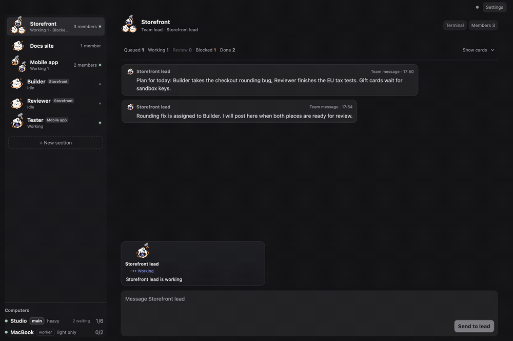
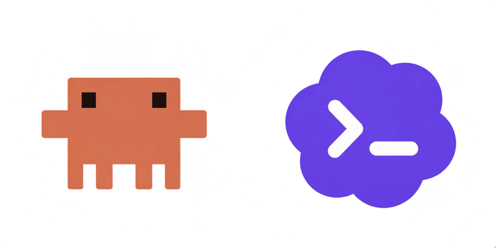

# HerdrDesk

HerdrDesk is an independent macOS companion for [Herdr](https://github.com/herdrdev/herdr-app). It groups live terminals by team, space and device, shows a selected terminal live, and lets you send work to a supported coding agent. The main interface is available in English, Korean and Japanese.



## Install

You need macOS 14 or later, Swift 6 (Xcode 16 or the Command Line Tools), Node.js 22, and [Herdr Core](https://github.com/herdrdev/herdr-core) for live use. The Herdr desktop app is optional: it is used to jump directly to a terminal and to read existing space and tab placement.

There is no signed download yet, so build it from source. The build uses your Mac's architecture.

```sh
git clone https://github.com/rimumomuri/herdrdesk.git
cd herdrdesk
./scripts/build.sh
cp -R build/HerdrDesk.app /Applications/
open /Applications/HerdrDesk.app
```

To update later, run `git pull` and the last three commands again.

HerdrDesk checks common install locations and your process PATH for `hc`. If it cannot find Core, choose the executable in the app. The language picker is in the upper-right corner. The app uses the system language on first launch if it is English, Korean or Japanese.

## Use it with your Herdr

1. Open your terminals or coding agents in Herdr.
2. Open HerdrDesk and select a terminal from the structure panel.
3. Open **Team Chats** to send to a team’s registered lead, or choose a member for a direct conversation. **Sent** means Core reported that it started delivery. A message can still await a receipt.
4. Use **Terminal** for live output. Click inside the terminal to type into it, for example to answer an approval prompt. Keys reach the terminal only while you have clicked into it and HerdrDesk is the active app. **Open in Herdr** switches to Herdr.
   To keep the terminal view read-only, launch HerdrDesk with `HERDRDESK_NO_SEND=1`. This also turns off sending work from HerdrDesk.

Core discovery works without a team configuration. If your Herdr terminal already has `team.id`, `team.title` or `display.title` labels, HerdrDesk uses those labels for grouping and display. For unlabelled terminals, it uses Herdr's space placement when available. The optional question helper records a question and links an approval destination to its active session. See [configuration](docs/configuration.md) and [release verification](docs/releasing.md).

The card board shown in the demo is optional. It appears when you provide an external `herdr-task` command, described in [configuration](docs/configuration.md#optional-card-board-and-computer-list). The same command can also back a settings sheet for each computer (turn work on or off, set the worker count, clone a project onto another Mac): see [computer settings sheet](docs/configuration.md#computer-settings-sheet).

## What you see

&nbsp;

- **Agents as characters.** A team lead is a sheep. It keeps its mouth closed, sleeps when idle, and opens its mouth to hold the agents it has handed work to (Claude or Codex) until they hand the result back. Its ring is orange for a Claude lead and violet for a Codex lead, and blends when the mouth holds both. The sidebar's team icon is the lead holding the team's workers. A worker spawned for a task card is simply its engine's character.
- **Motion that means something.** A working agent bobs with a hammer and glows in its colour, and a light runs around a lead's ring, faster while it works. Hover a face to make it hop. Motion stops when macOS *Reduce motion* is on.
- **Team flows.** Above the composer, a team room shows every flow running in the team, one row each: who handed work to whom, who is working now and who is waiting on whom. While someone works on a handoff, light runs down the arrow and is absorbed into them. A direct conversation shows that agent's own chain.
- **Working time.** Every working status shows how long the agent has been at it, as the terminal does (*Working now · 3m 12s*), in the sidebar, the member list, the activity line and the rail.
- **Questions and approvals.** An agent's registered question is answered in the conversation, with its choices; an approval opens the right Herdr terminal.
- **Files in replies.** A link to a saved web page opens in your default browser; a Markdown file opens in an in-app viewer.
- **Floating companion.** A small character outside the window (also over full-screen video) shows who needs you and who is working. Click it to open HerdrDesk.

## Privacy

Core is accessed locally and through the remote connections already configured in Herdr. HerdrDesk does not run a cloud service. Terminal output is streamed for the selected session, discarded when observation ends and excluded from saved chat history. Outgoing drafts and local send records are stored on the Mac.

## Credits

HerdrDesk uses [Herdr Core](https://github.com/herdrdev/herdr-core) as an external dependency. It bundles [xterm.js](https://github.com/xtermjs/xterm.js) 6.0.0 with a small Content Security Policy adaptation. See [third-party notices](THIRD_PARTY_NOTICES.md).

## Contributing

Bug reports and pull requests are welcome. See [CONTRIBUTING.md](CONTRIBUTING.md). Please report security problems privately as described in [SECURITY.md](SECURITY.md).

## License

HerdrDesk is released under the [MIT License](LICENSE). HerdrDesk is an independent project and is not affiliated with or endorsed by the Herdr project.
