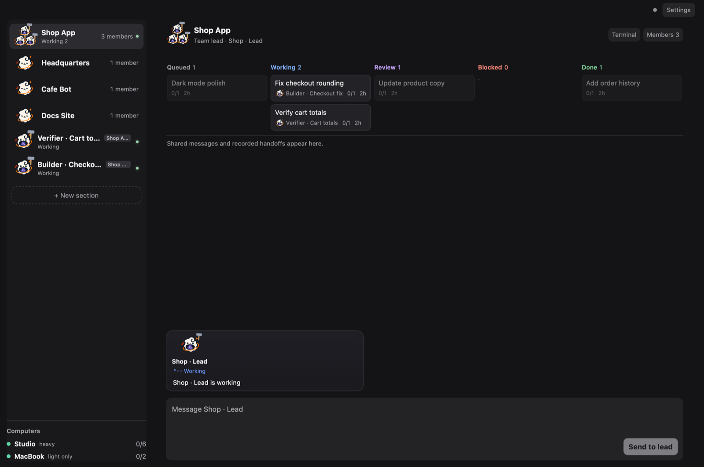

# HerdrDesk

HerdrDesk is an independent macOS companion for [Herdr](https://github.com/herdrdev/herdr-app). It groups live terminals by team, space and device, displays a selected terminal in read-only mode, and lets you send work to a supported coding agent. The main interface is available in English, Korean and Japanese.



## Build and run locally

You need macOS 14 or later, Swift 6, Node.js 22, and [Herdr Core](https://github.com/herdrdev/herdr-core) for live use. The Herdr desktop app is used to jump directly to a terminal and to read existing space and tab placement. Local builds use your Mac's architecture.

```sh
./scripts/build.sh
open build/HerdrDesk.app
```

HerdrDesk checks common install locations and your process PATH for `hc`. If it cannot find Core, choose the executable in the app. The language picker is in the upper-right corner. The app uses the system language on first launch if it is English, Korean or Japanese.

## Use it with your Herdr

1. Open your terminals or coding agents in Herdr.
2. Open HerdrDesk and select a terminal from the structure panel.
3. Open **Team Chats** to send to a team’s registered lead, or choose a member for a direct conversation. **Sent** means Core reported that it started delivery. A message can still await a receipt.
4. Use **Terminal** for live, read-only output. **Open in Herdr** switches to Herdr for typing and approval.

Core discovery works without a team configuration. If your Herdr terminal already has `team.id`, `team.title` or `display.title` labels, HerdrDesk uses those labels for grouping and display. For unlabelled terminals, it uses Herdr's space placement when available. The optional question helper records a question and links an approval destination to its active session. See [configuration](docs/configuration.md) and [release verification](docs/releasing.md).

## Privacy

Core is accessed locally and through the remote connections already configured in Herdr. HerdrDesk does not run a cloud service. Terminal output is streamed for the selected session, discarded when observation ends and excluded from saved chat history. Outgoing drafts and local send records are stored on the Mac.

## Credits

HerdrDesk uses [Herdr Core](https://github.com/herdrdev/herdr-core) as an external dependency. It bundles [xterm.js](https://github.com/xtermjs/xterm.js) 6.0.0 with a small Content Security Policy adaptation. See [third-party notices](THIRD_PARTY_NOTICES.md).

## Contributing

Bug reports and pull requests are welcome. See [CONTRIBUTING.md](CONTRIBUTING.md). Please report security problems privately as described in [SECURITY.md](SECURITY.md).

## License

HerdrDesk is released under the [MIT License](LICENSE). HerdrDesk is an independent project and is not affiliated with or endorsed by the Herdr project.
